


 

i run **play'n chill**, build **verse** tools for fortnite creators, 
and ship **hangar**, an open-source cockpit for coding agents.

 

### <samp>❯ ./hangar</samp>

**Claude Code, Codex, Gemini CLI and OpenCode side by side.** 
shared task board · git-worktree orchestration · steer it all from your phone

<samp>11 kits in the <a href="https://github.com/hangar-ai">hangar-ai</a> org: tabs, skills and hooks for your agents</samp> 

 

### <samp>❯ ls ~/open-source</samp>

<a href="https://github.com/Stake-Dev-Tool/stake-dev-tool">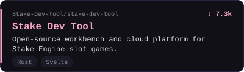</a>
<a href="https://github.com/boykopovar/AnyPS5">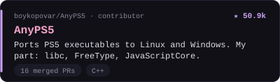</a>
<a href="https://github.com/simnJS/prism-verse">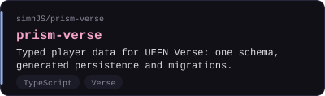</a>
<a href="https://github.com/simnJS/verse-native-bench">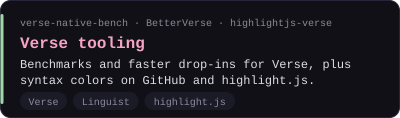</a>

> i got **Verse** into [GitHub Linguist](https://github.com/github-linguist/linguist/pull/7440) and [highlight.js](https://github.com/highlightjs/highlight.js/pull/4524), so `.verse` files finally get colors on GitHub 💗

### <samp>❯ ls ~/studios</samp>

<a href="https://playandchill.bet">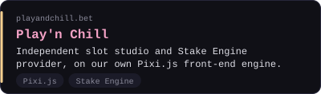</a>
<a href="https://www.roblox.com/communities/35788348/Playn-Chill">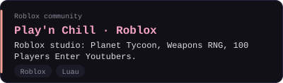</a>
<a href="https://store.simnjs.fr">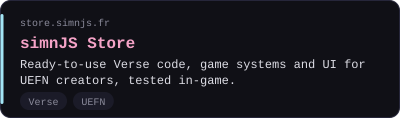</a>
<a href="https://tacline.co">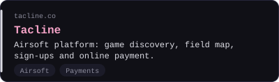</a>

also worked with Lofi Girl, Epic Games, Banco de Chile and Chhetz Creative.

 

### <samp>❯ cat stack.toml</samp>

<table>
  <tr>
    <td><samp>[games]</samp></td>
    <td>
      
      
      
      
      
    </td>
  </tr>
  <tr>
    <td><samp>[web]</samp></td>
    <td>
      
      
      
      
      
      
      
      
    </td>
  </tr>
  <tr>
    <td><samp>[systems]</samp></td>
    <td>
      
      
      
      
    </td>
  </tr>
  <tr>
    <td><samp>[ai]</samp></td>
    <td>
      
      
    </td>
  </tr>
</table>

### <samp>❯ gh stats</samp>

  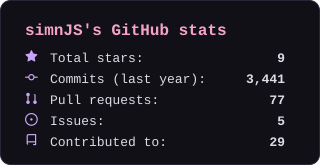
  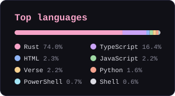

 

<samp>❯ exit</samp>

